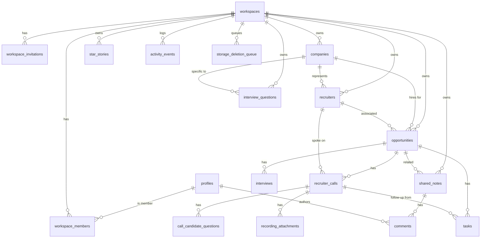

# Database Schema

Status: **Proposed** · Target: Supabase PostgreSQL 15+
Related: [SECURITY_MODEL](./SECURITY_MODEL.md) (RLS policies) · [RECORDING_STORAGE](./RECORDING_STORAGE.md)

## 1. Conventions

| Topic | Convention |
| --- | --- |
| Schema | Domain tables in `public` (exposed to the Data API, protected by RLS). Helper functions in `app` schema (not exposed). |
| Primary keys | `uuid` default `gen_random_uuid()` |
| Tenancy | Every domain row has `workspace_id uuid not null`. Child rows reference parents with **composite foreign keys** `(parent_id, workspace_id)` so a row can never link to a record in another workspace. |
| Timestamps | `timestamptz`; `created_at default now()`, `updated_at` maintained by trigger `app.set_updated_at()` |
| Date-only values | `date` (task due dates) |
| Enumerations | `text` + `CHECK` constraint (easier to evolve than Postgres enums) |
| Lists of short strings | `text[]` (skills, topics, themes, red flags) with `CHECK (cardinality(x) <= 50)` |
| Names | `snake_case` in SQL; API maps to `camelCase` |
| Soft delete | Only where needed for workflows (`recording_attachments`, `comments`). Everything else hard-deletes with FK cascades. |
| Audio | **Never stored in Postgres.** Only object metadata and storage path. |

## 2. Entity relationship diagram



Cardinalities required by the product: a company has many opportunities; an opportunity
has many calls, interviews and tasks; a call has many recording attachments.

## 3. Mapping from frontend models

| Frontend type (`src/types`) | Table | Notes |
| --- | --- | --- |
| `User` | `profiles` (+ `auth.users`) | `title` → `headline` |
| `Workspace` | `workspaces` | |
| `Collaborator` | `workspace_members` + `workspace_invitations` | Pending collaborators are invitations; active ones are members joined to `profiles` |
| `Company` | `companies` | `industry`/`headquarters` nullable (UI currently writes `"—"`) |
| `Recruiter` | `recruiters` | `company_id` nullable (agency recruiters may span companies) |
| `Opportunity` | `opportunities` | `compensation` flattened to `comp_*` columns |
| `RecruiterCall` | `recruiter_calls` | `candidateQuestions` → `call_candidate_questions` |
| `RecordingAttachment` | `recording_attachments` | `storage`/`remoteUrl` replaced by `status` + `object_path`; URLs are never stored |
| `Interview` | `interviews` | |
| `FollowUpTask`, `PreparationTask` | `tasks` (`kind`) | `completed` derived from `completed_at` |
| `StarStory` | `star_stories` | |
| `InterviewQuestion` | `interview_questions` | |
| `SharedNote` | `shared_notes` | `updatedBy` → `updated_by uuid` |
| `Comment` | `comments` | `authorName` → `author_id uuid` |
| `ActivityEvent` | `activity_events` | `actorName` → `actor_id uuid`; description rendered by UI from `action` + `metadata` |

## 4. Tables (DDL sketch)

> DDL is illustrative for review; final SQL lives in `supabase/migrations/`.

### 4.1 Identity and workspaces

```sql
create extension if not exists citext;
create extension if not exists pg_trgm;

create table public.profiles (
  id            uuid primary key references auth.users(id) on delete cascade,
  email         citext not null unique,
  display_name  text not null check (char_length(display_name) between 1 and 120),
  headline      text check (char_length(headline) <= 200),
  created_at    timestamptz not null default now(),
  updated_at    timestamptz not null default now()
);

create table public.workspaces (
  id                       uuid primary key default gen_random_uuid(),
  name                     text not null check (char_length(name) between 1 and 120),
  owner_id                 uuid not null references public.profiles(id),
  recording_retention_days int check (recording_retention_days in (30, 90, 180, 365)),  -- null = keep until deleted
  storage_quota_bytes      bigint not null default 2147483648,                          -- 2 GiB
  created_at               timestamptz not null default now(),
  updated_at               timestamptz not null default now()
);

create table public.workspace_members (
  workspace_id  uuid not null references public.workspaces(id) on delete cascade,
  user_id       uuid not null references public.profiles(id) on delete cascade,
  role          text not null check (role in ('owner','editor','commenter','viewer')),
  created_at    timestamptz not null default now(),
  primary key (workspace_id, user_id)
);
create unique index workspace_one_owner on public.workspace_members(workspace_id) where role = 'owner';
create index workspace_members_user on public.workspace_members(user_id);

create table public.workspace_invitations (
  id            uuid primary key default gen_random_uuid(),
  workspace_id  uuid not null references public.workspaces(id) on delete cascade,
  email         citext not null,
  role          text not null check (role in ('editor','commenter','viewer')),   -- never owner
  token_hash    bytea not null unique,                                            -- sha256(token); raw token only in the email
  invited_by    uuid not null references public.profiles(id),
  status        text not null default 'pending' check (status in ('pending','accepted','revoked','expired')),
  expires_at    timestamptz not null default now() + interval '7 days',
  accepted_by   uuid references public.profiles(id),
  accepted_at   timestamptz,
  created_at    timestamptz not null default now()
);
create unique index invitations_one_pending on public.workspace_invitations(workspace_id, email) where status = 'pending';
```

### 4.2 Pipeline: companies, recruiters, opportunities

```sql
create table public.companies (
  id            uuid primary key default gen_random_uuid(),
  workspace_id  uuid not null references public.workspaces(id) on delete cascade,
  name          text not null check (char_length(name) between 1 and 200),
  industry      text check (char_length(industry) <= 120),
  headquarters  text check (char_length(headquarters) <= 120),
  website       text check (website ~* '^https?://'),
  created_at    timestamptz not null default now(),
  updated_at    timestamptz not null default now(),
  unique (id, workspace_id)
);
create unique index companies_name_per_ws on public.companies(workspace_id, lower(name));

create table public.recruiters (
  id            uuid primary key default gen_random_uuid(),
  workspace_id  uuid not null references public.workspaces(id) on delete cascade,
  company_id    uuid,
  name          text not null check (char_length(name) between 1 and 120),
  email         citext check (email ~ '^\S+@\S+\.\S+$'),
  phone         text check (char_length(phone) <= 40),
  agency        text check (char_length(agency) <= 120),
  created_at    timestamptz not null default now(),
  updated_at    timestamptz not null default now(),
  unique (id, workspace_id),
  foreign key (company_id, workspace_id) references public.companies(id, workspace_id) on delete set null (company_id)
);

create table public.opportunities (
  id               uuid primary key default gen_random_uuid(),
  workspace_id     uuid not null references public.workspaces(id) on delete cascade,
  company_id       uuid not null,
  recruiter_id     uuid,
  title            text not null check (char_length(title) between 1 and 200),
  location         text not null default '' check (char_length(location) <= 200),
  work_mode        text not null check (work_mode in ('remote','hybrid','onsite')),
  employment_type  text not null check (employment_type in ('full_time','contract','contract_to_hire','part_time')),
  comp_min         numeric(12,2) check (comp_min >= 0),
  comp_max         numeric(12,2),
  comp_currency    char(3) not null default 'USD',
  comp_period      text check (comp_period in ('year','hour')),
  stage            text not null default 'new'
                   check (stage in ('new','recruiter_screen','technical','hiring_manager','offer','closed')),
  job_description  text not null default '' check (char_length(job_description) <= 20000),
  required_skills  text[] not null default '{}' check (cardinality(required_skills) <= 50),
  preferred_skills text[] not null default '{}' check (cardinality(preferred_skills) <= 50),
  prep_notes       text not null default '' check (char_length(prep_notes) <= 20000),
  stage_changed_at timestamptz not null default now(),
  created_by       uuid references public.profiles(id) on delete set null,
  created_at       timestamptz not null default now(),
  updated_at       timestamptz not null default now(),
  unique (id, workspace_id),
  foreign key (company_id, workspace_id) references public.companies(id, workspace_id) on delete restrict,
  foreign key (recruiter_id, workspace_id) references public.recruiters(id, workspace_id) on delete set null (recruiter_id),
  check ((comp_min is null) = (comp_max is null) and (comp_min is null) = (comp_period is null)),
  check (comp_max is null or comp_max >= comp_min)
);
create index opportunities_ws_stage on public.opportunities(workspace_id, stage, updated_at desc);
create index opportunities_title_trgm on public.opportunities using gin (title gin_trgm_ops);
```

### 4.3 Calls and recordings

```sql
create table public.recruiter_calls (
  id                        uuid primary key default gen_random_uuid(),
  workspace_id              uuid not null references public.workspaces(id) on delete cascade,
  opportunity_id            uuid not null,
  recruiter_id              uuid,
  call_at                   timestamptz not null,
  duration_minutes          int not null check (duration_minutes between 1 and 600),
  hiring_manager_priorities text[] not null default '{}' check (cardinality(hiring_manager_priorities) <= 50),
  interview_stages          text[] not null default '{}' check (cardinality(interview_stages) <= 30),
  recruiter_advice          text not null default '' check (char_length(recruiter_advice) <= 10000),
  technical_topics          text[] not null default '{}' check (cardinality(technical_topics) <= 50),
  behavioral_themes         text[] not null default '{}' check (cardinality(behavioral_themes) <= 50),
  red_flags                 text[] not null default '{}' check (cardinality(red_flags) <= 50),
  interest_level            smallint not null check (interest_level between 1 and 10),
  notes                     text not null default '' check (char_length(notes) <= 100000),
  created_by                uuid references public.profiles(id) on delete set null,
  created_at                timestamptz not null default now(),
  updated_at                timestamptz not null default now(),
  unique (id, workspace_id),
  foreign key (opportunity_id, workspace_id) references public.opportunities(id, workspace_id) on delete cascade,
  foreign key (recruiter_id, workspace_id) references public.recruiters(id, workspace_id) on delete set null (recruiter_id)
);
create index calls_ws_time on public.recruiter_calls(workspace_id, call_at desc);
create index calls_opportunity on public.recruiter_calls(opportunity_id);

create table public.call_candidate_questions (
  id            uuid primary key default gen_random_uuid(),
  workspace_id  uuid not null,
  call_id       uuid not null,
  position      smallint not null check (position >= 0),
  question      text not null check (char_length(question) <= 2000),
  answer        text not null default '' check (char_length(answer) <= 5000),
  foreign key (call_id, workspace_id) references public.recruiter_calls(id, workspace_id) on delete cascade,
  unique (call_id, position)
);

create table public.recording_attachments (
  id                   uuid primary key default gen_random_uuid(),
  workspace_id         uuid not null,
  call_id              uuid not null,
  bucket               text not null default 'recordings',
  object_path          text not null unique,   -- {workspace_id}/{call_id}/{id}.{ext}; never user-supplied
  original_filename    text not null check (char_length(original_filename) between 1 and 255),
  mime_type            text not null check (mime_type in ('audio/mpeg','audio/mp4','audio/wav')),
  size_bytes           bigint not null check (size_bytes > 0),
  duration_seconds     int check (duration_seconds between 0 and 86400),
  status               text not null default 'pending_upload'
                       check (status in ('pending_upload','uploaded','failed','deleted')),
  failure_reason       text,
  consent_attested_at  timestamptz not null,    -- uploader confirmed they had the right to record/store
  uploaded_by          uuid references public.profiles(id) on delete set null,
  created_at           timestamptz not null default now(),
  uploaded_at          timestamptz,
  delete_after         timestamptz,             -- retention deadline (null = keep until deleted)
  deleted_at           timestamptz,
  foreign key (call_id, workspace_id) references public.recruiter_calls(id, workspace_id) on delete cascade,
  check (status <> 'uploaded' or (uploaded_at is not null and deleted_at is null)),
  check (status <> 'deleted' or deleted_at is not null)
);
create index recordings_call on public.recording_attachments(call_id) where status <> 'deleted';
create index recordings_ws_status on public.recording_attachments(workspace_id, status);
create index recordings_retention on public.recording_attachments(delete_after) where status = 'uploaded';

-- Storage objects are not removed by FK cascades; deletes enqueue paths for the purge job.
create table public.storage_deletion_queue (
  id            bigserial primary key,
  workspace_id  uuid not null,            -- no FK: must survive workspace deletion
  bucket        text not null,
  object_path   text not null,
  reason        text not null check (reason in ('user_delete','cascade','retention','abandoned','failed_validation','account_deletion')),
  enqueued_at   timestamptz not null default now(),
  attempts      int not null default 0,
  last_error    text,
  completed_at  timestamptz
);
create index deletion_queue_pending on public.storage_deletion_queue(enqueued_at) where completed_at is null;
```

### 4.4 Interviews and tasks

```sql
create table public.interviews (
  id                uuid primary key default gen_random_uuid(),
  workspace_id      uuid not null,
  opportunity_id    uuid not null,
  title             text not null check (char_length(title) between 1 and 200),
  stage             text not null check (stage in ('recruiter_screen','technical','hiring_manager','offer')),
  scheduled_at      timestamptz not null,
  duration_minutes  int not null check (duration_minutes between 1 and 1440),
  format            text not null check (format in ('video','phone','onsite')),
  interviewers      text[] not null default '{}' check (cardinality(interviewers) <= 20),
  status            text not null default 'scheduled' check (status in ('scheduled','completed','cancelled','rescheduled')),
  outcome           text not null default 'pending' check (outcome in ('pending','advanced','rejected','offer')),
  notes             text not null default '' check (char_length(notes) <= 10000),
  created_at        timestamptz not null default now(),
  updated_at        timestamptz not null default now(),
  foreign key (opportunity_id, workspace_id) references public.opportunities(id, workspace_id) on delete cascade
);
create index interviews_ws_time on public.interviews(workspace_id, scheduled_at);

create table public.tasks (
  id              uuid primary key default gen_random_uuid(),
  workspace_id    uuid not null,
  opportunity_id  uuid not null,
  kind            text not null check (kind in ('follow_up','preparation')),
  call_id         uuid,
  category        text check (category in ('technical','behavioral','research','logistics')),
  title           text not null check (char_length(title) between 1 and 300),
  due_date        date,
  completed_at    timestamptz,
  created_by      uuid references public.profiles(id) on delete set null,
  created_at      timestamptz not null default now(),
  updated_at      timestamptz not null default now(),
  foreign key (opportunity_id, workspace_id) references public.opportunities(id, workspace_id) on delete cascade,
  foreign key (call_id, workspace_id) references public.recruiter_calls(id, workspace_id) on delete cascade,
  check (kind = 'preparation' or (category is null and due_date is not null)),   -- follow-ups need a due date
  check (kind = 'follow_up' or (call_id is null and category is not null))
);
create index tasks_ws_kind_due on public.tasks(workspace_id, kind, due_date) where completed_at is null;
create index tasks_opportunity on public.tasks(opportunity_id);
create unique index tasks_one_followup_per_call on public.tasks(call_id) where kind = 'follow_up';
```

> `tasks_one_followup_per_call` encodes the current UI rule (a call's "Next action" is one
> follow-up). Additional follow-ups for an opportunity are created without `call_id`.

### 4.5 Preparation content

```sql
create table public.star_stories (
  id            uuid primary key default gen_random_uuid(),
  workspace_id  uuid not null references public.workspaces(id) on delete cascade,
  title         text not null check (char_length(title) between 1 and 200),
  situation     text not null default '' check (char_length(situation) <= 5000),
  task          text not null default '' check (char_length(task) <= 5000),
  action        text not null default '' check (char_length(action) <= 5000),
  result        text not null default '' check (char_length(result) <= 5000),
  themes        text[] not null default '{}' check (cardinality(themes) <= 20),
  created_at    timestamptz not null default now(),
  updated_at    timestamptz not null default now()
);

create table public.interview_questions (
  id            uuid primary key default gen_random_uuid(),
  workspace_id  uuid not null references public.workspaces(id) on delete cascade,
  company_id    uuid,
  type          text not null check (type in ('technical','behavioral')),
  topic         text not null check (char_length(topic) between 1 and 80),
  difficulty    text not null check (difficulty in ('easy','medium','hard')),
  question      text not null check (char_length(question) between 1 and 2000),
  answer_notes  text not null default '' check (char_length(answer_notes) <= 20000),
  created_at    timestamptz not null default now(),
  updated_at    timestamptz not null default now(),
  foreign key (company_id, workspace_id) references public.companies(id, workspace_id) on delete set null (company_id)
);
create index questions_ws_topic on public.interview_questions(workspace_id, type, topic);
create index questions_text_trgm on public.interview_questions using gin (question gin_trgm_ops);
```

### 4.6 Collaboration

```sql
create table public.shared_notes (
  id              uuid primary key default gen_random_uuid(),
  workspace_id    uuid not null references public.workspaces(id) on delete cascade,
  opportunity_id  uuid,
  title           text not null check (char_length(title) between 1 and 200),
  body            text not null default '' check (char_length(body) <= 100000),
  version         int not null default 1,           -- optimistic concurrency
  created_by      uuid references public.profiles(id) on delete set null,
  updated_by      uuid references public.profiles(id) on delete set null,
  created_at      timestamptz not null default now(),
  updated_at      timestamptz not null default now(),
  unique (id, workspace_id),
  foreign key (opportunity_id, workspace_id) references public.opportunities(id, workspace_id) on delete set null (opportunity_id)
);

create table public.comments (
  id            uuid primary key default gen_random_uuid(),
  workspace_id  uuid not null,
  note_id       uuid not null,
  author_id     uuid references public.profiles(id) on delete set null,
  body          text not null check (char_length(body) between 1 and 5000),
  created_at    timestamptz not null default now(),
  edited_at     timestamptz,
  deleted_at    timestamptz,
  foreign key (note_id, workspace_id) references public.shared_notes(id, workspace_id) on delete cascade
);
create index comments_note on public.comments(note_id, created_at);

create table public.activity_events (
  id            bigserial primary key,
  workspace_id  uuid not null references public.workspaces(id) on delete cascade,
  actor_id      uuid references public.profiles(id) on delete set null,
  action        text not null,   -- e.g. 'opportunity.stage_changed', 'call.created', 'member.invited'
  entity_type   text not null,
  entity_id     uuid,
  metadata      jsonb not null default '{}'::jsonb check (pg_column_size(metadata) <= 4096),
  created_at    timestamptz not null default now()
);
create index activity_ws_time on public.activity_events(workspace_id, created_at desc);
```

Activity metadata holds labels needed to render the entry (e.g. `{"title": "...", "from": "technical", "to": "offer"}`),
**never** call notes, recording paths, contact details or signed URLs. Activity rows are
append-only (no UPDATE/DELETE grants).

## 5. Functions and triggers

| Name | Type | Purpose |
| --- | --- | --- |
| `app.set_updated_at()` | trigger | Maintain `updated_at` on all mutable tables |
| `app.handle_new_user()` | trigger on `auth.users` insert, `SECURITY DEFINER` | Create `profiles` row, a personal workspace, and an `owner` membership |
| `app.role_rank(text)` | immutable | owner 4, editor 3, commenter 2, viewer 1 |
| `app.has_workspace_role(ws uuid, min_role text)` | `STABLE SECURITY DEFINER`, `search_path = ''` | Membership check used by every RLS policy |
| `public.log_recruiter_call(payload jsonb)` | RPC, `SECURITY INVOKER` | One transaction: find-or-create company, create/update recruiter, create/update opportunity, upsert call, replace candidate questions, upsert follow-up, write activity. Returns IDs. |
| `public.update_recruiter_call(call_id uuid, payload jsonb)` | RPC, `SECURITY INVOKER` | Same as above for edits |
| `public.set_opportunity_stage(id uuid, stage text)` | RPC, `SECURITY INVOKER` | Update stage + `stage_changed_at` + activity event |
| `public.accept_invitation(token text)` | RPC, `SECURITY DEFINER` | Verify token hash, expiry, email match with `auth.email()`; create membership; mark accepted |
| `public.transfer_ownership(ws uuid, new_owner uuid)` | RPC, `SECURITY DEFINER` | Owner-only; swaps roles atomically |
| `app.enqueue_recording_deletion()` | trigger `BEFORE DELETE` on `recording_attachments` | Enqueue object path to `storage_deletion_queue` (covers FK cascades from call/opportunity/workspace deletes) |
| `app.bump_note_version()` | trigger | Increment `shared_notes.version` on update |
| `app.log_activity(...)` | `SECURITY DEFINER` helper | Insert into `activity_events` (only callable from other functions) |

All `SECURITY DEFINER` functions set `search_path = ''`, fully qualify objects, check
`auth.uid()` explicitly, and are owned by a role without login. `EXECUTE` is revoked from
`public`/`anon` and granted only to `authenticated` where intended.

## 6. Derived values (must match frontend selectors)

| Metric | SQL definition |
| --- | --- |
| Total recruiter calls | `count(*) from recruiter_calls where workspace_id = $1` |
| Active opportunities | `stage <> 'closed'` |
| Upcoming interviews | `status = 'scheduled' and scheduled_at >= now()` |
| Pending follow-ups | `kind = 'follow_up' and completed_at is null` |
| Overdue follow-ups | pending and `due_date < current_date` (evaluated in the user's time zone — the API accepts `tz`) |
| Skill frequency | `unnest(technical_topics)` from calls ∪ `unnest(required_skills)` from opportunities, grouped case-insensitively |

## 7. Seed and migration policy

- `supabase/seed.sql` loads the existing **fictional** dataset (ported from `src/data/mock-data.ts`) into local/staging only. Never run against production.
- Migrations are forward-only, reviewed, and include RLS for any new table in the **same** migration (CI fails if a `public` table lacks RLS — see TEST_PLAN).
- Destructive changes use expand → migrate → contract across releases.

## 8. Capacity assumptions (MVP)

Per workspace: ≤ 5,000 calls, ≤ 1,000 opportunities, ≤ 2 GiB recordings, ≤ 20 members.
Indexes above keep list queries index-only on `workspace_id` + sort key at this scale.
