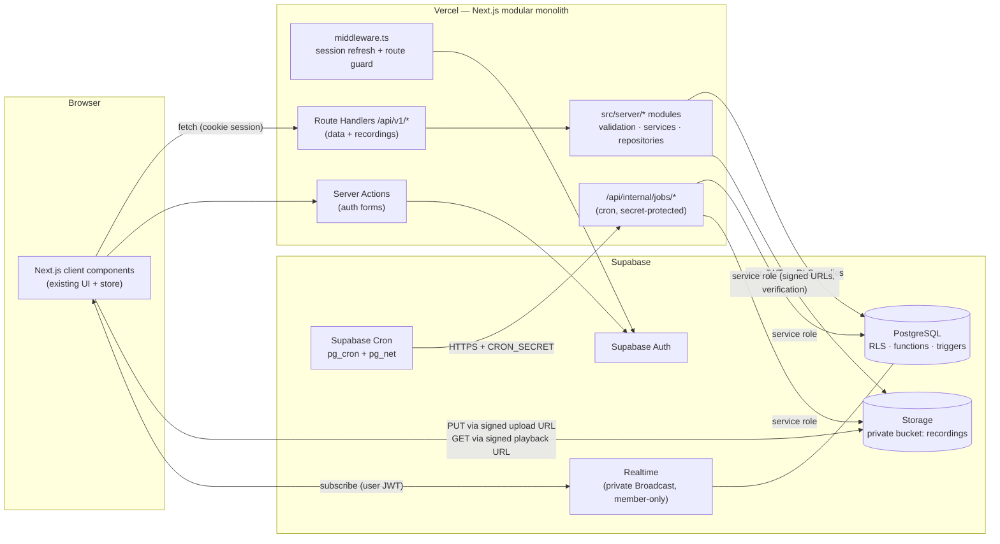
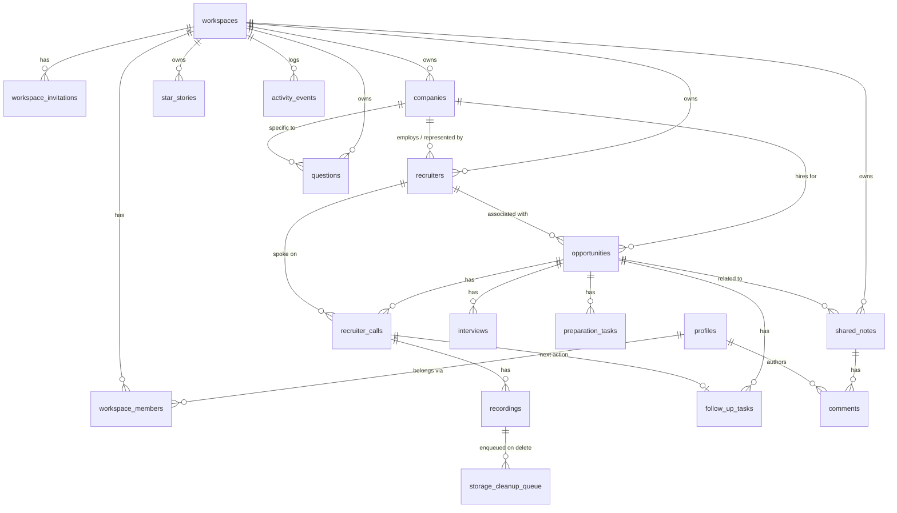
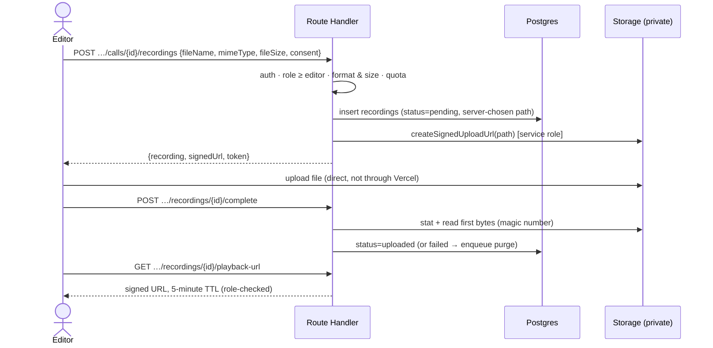
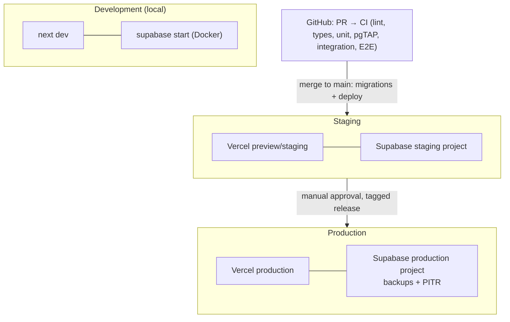

# Backend Architecture

| | |
| --- | --- |
| Status | **Approved** (D2–D10 as recommended, 2026-10-24). Implemented so far: Phases 1–4 (local environment, database, authentication/authorization, application services). |
| Audited commit | `8c73867` (branch `docs/backend-architecture-plan`; frontend at `80960f1` on `main`) |
| Supersedes | The earlier planning drafts (`docs/*.md`), removed in Phase 2 per D8; still available in git history (commit `8c73867`). |

---

## 1. Audit summary

### 1.1 What exists

| Area | State |
| --- | --- |
| Stack | Next.js 15.5 (App Router), React 19, TypeScript strict, Tailwind v4, shadcn/ui (Radix). Deps: `next`, `react`, `radix-ui`, `lucide-react`, `clsx`, `tailwind-merge`, `class-variance-authority`. |
| Pages | Overview, Recruiter Calls (list / new / detail+edit), Opportunities (list / detail), Interviews & Follow-ups, Interview Preparation, Question Bank, Shared Workspace, Settings, `not-found`, `error`. |
| Types | `src/types/index.ts` — 17 domain interfaces with ID-based relationships (`Company`, `Recruiter`, `Opportunity`, `RecruiterCall`, `RecordingAttachment`, `Interview`, `FollowUpTask`, `PreparationTask`, `StarStory`, `InterviewQuestion`, `SharedNote`, `Comment`, `ActivityEvent`, `Collaborator`, `Workspace`, `User`, `AppData`). |
| Data | `src/data/mock-data.ts` — fictional dataset (5 companies, 6 opportunities, 8 calls, 6 interviews, 7 follow-ups, 9 prep tasks, 3 STAR stories, 18 questions, 2 notes). |
| State | One React Context + `useReducer` store (`src/lib/store/`), pure selectors, and `useActions()` exposing **29 synchronous mutations**. |
| Workflows complete (UI only) | Call CRUD with tabbed form; local audio attach + playback; opportunity pipeline; prep checklist; STAR stories; question bank; interviews/follow-ups; collaboration *visuals*. All verified with ad-hoc Playwright runs (recorded in `FRONTEND_PROGRESS.md`). |

### 1.2 What does not exist

No authentication, no server code (`fetch`, Route Handlers, Server Actions: none), no persistence (reload resets data), no permission-aware UI, no automated tests in the repo, identity stored as display-name strings (`authorName`, `actorName`, `updatedBy`).

### 1.3 Integration requirements

1. Every `useActions()` mutation becomes **async and fallible** → pending/error/retry UI.
2. The call form writes up to five records in one save (company, recruiter, opportunity, call, follow-up) → must be **one database transaction**.
3. Mock-data initialization replaced by authenticated loads; mock data kept only for a demo flag.
4. Due dates are timestamps in the UI today → backend stores `date`.
5. Recording UI must move from in-memory `File` previews to upload + signed-URL playback.
6. Auth pages (register, login, logout, password reset) and route protection must be added.

### 1.4 Inconsistencies and gaps in the specification (decisions in §11)

| # | Finding | Proposed resolution |
| --- | --- | --- |
| G1 | The required table list has no follow-up table, but a Follow-ups module is required and the UI tracks follow-ups separately from prep tasks. | Add `follow_up_tasks`. |
| G2 | `comments` is required, but nothing to comment *on* is listed; the UI attaches comments to shared notes. | Add `shared_notes`; `comments.note_id` references it. |
| G3 | STAR stories exist in the UI but are not in the table list. | Add `star_stories` (otherwise that feature loses persistence). |
| G4 | Recruiter-call Q&A (`candidateQuestions`) has no home. | `jsonb` array column on `recruiter_calls` (validated), not a separate table. |
| G5 | DB cascades delete `recordings` rows but cannot delete Storage objects. | Small `storage_cleanup_queue` table filled by trigger and drained by a job. |
| G6 | The permission matrix does not say who may **play** recordings, delete records, or edit/delete comments. | §5.2 proposes rules; recording playback needs a decision (D4). |
| G7 | "Password reset" implies email+password auth; earlier drafts proposed magic links. | Email + password (+ confirmation); OAuth deferred. |
| G8 | Earlier drafts unified tasks into one `tasks` table and named recordings `recording_attachments`. | Follow this spec: `preparation_tasks`, `follow_up_tasks`, `recordings` with the specified columns. |
| G9 | Hosted email (confirmation, reset, invites) needs SMTP in staging/production; Supabase's built-in mailer is rate-limited and for testing only. | Configure a provider before staging (D9). |

### 1.5 Environment findings (this cloud workspace)

| Check | Result |
| --- | --- |
| Node.js / npm | v22.22.0 / 10.9.4 ✅ |
| Docker engine | Installed; daemon **can be started** (overlayfs, cgroup v1) ✅ |
| Supabase CLI | `supabase@2.122.0` installs and runs via npm ✅ |
| Pull Supabase images | ❌ **Blocked**: `public.ecr.aws` → "Data limit exceeded"; Docker Hub → `429 Too Many Requests`; GHCR blob host (`pkg-containers.githubusercontent.com`) → denied by network policy |
| `api.supabase.com`, `supabase.com` | ❌ Denied by network policy (needed only to link staging/production projects) |
| Plain PostgreSQL 16 binaries | ✅ Available (used to validate the planning DDL) |

**Consequence (Phase 0):** `supabase start` could not run until image pulls worked (decision **D1**).
**Update (Phase 1, 2026-10-24): resolved.** Docker Hub served all images after rate-limit retries; the full local stack runs. See [`ENVIRONMENT.md`](./ENVIRONMENT.md).

---

## 2. System architecture



### 2.1 Request lifecycle

1. `middleware.ts` refreshes the Supabase session cookie; unauthenticated app routes redirect to `/login`, API routes return `401`.
2. A Route Handler validates input with a shared **zod** schema, resolves the workspace from the URL, checks the caller's role, and calls a module service.
3. The service queries Postgres with a **request-scoped client carrying the user's JWT**, so RLS applies to every query. Multi-record writes call a Postgres function (single transaction).
4. Results are mapped to typed response contracts (camelCase); internal errors are logged with a request ID and returned as generic messages.

### 2.2 Module layout (modular monolith)

```
src/
├── app/(auth)/login · register · forgot-password; app/reset-password # auth pages
├── app/(app)/…                                                      # authenticated pages (layout checks the user)
├── app/auth/confirm/route.ts                                        # email link verification (token_hash)
├── app/api/v1/workspaces/[workspaceId]/...                          # Route Handlers (thin)
├── app/api/internal/jobs/...                                        # cron targets
├── app/api/health/route.ts                                          # health check
├── middleware.ts
├── server/                         # import "server-only"
│   ├── core/          supabase clients, auth context, errors, pagination, logger
│   ├── workspaces/    workspaces, members, invitations
│   ├── recruitment/   companies, recruiters, opportunities, recruiter calls
│   ├── recordings/    upload init/complete, playback, deletion, cleanup
│   ├── interviews/
│   ├── preparation/   preparation tasks, questions, STAR stories
│   ├── followups/
│   └── collaboration/ notes, comments, activity, realtime helpers
├── shared/contracts/  zod schemas + inferred types (client + server)
└── features/ …        existing UI modules (changed only for integration)
supabase/
├── config.toml · migrations/ · seed.sql (fictional) · tests/ (pgTAP)
```

Rules: Route Handlers contain no business logic; modules expose services, not tables; the UI imports only `shared/contracts` from the backend side.

---

## 3. Technology decisions

| Decision | Choice | Rationale |
| --- | --- | --- |
| Architecture | Modular monolith inside the existing Next.js app | One deployable, shared types, matches team size; no Express/NestJS/microservices |
| Data API | **Route Handlers** (`/api/v1`, JSON) for all data and recording operations | The UI is entirely client components with a client store; explicit HTTP contracts are easy to document, version, rate-limit and integration-test |
| Server Actions | Auth forms only (register, login, logout, reset) | Progressive enhancement and built-in origin checks where a form posts directly; avoids two parallel data-access styles |
| Database | Supabase PostgreSQL 15+ | Relational model fits the existing normalized types |
| Authorization | RLS on every `public` table + role checks in services | Supabase's Data API is publicly reachable with the anon key, so the database must enforce access on its own |
| Transactions | `SECURITY INVOKER` Postgres functions for composite writes | Atomic under RLS; supabase-js has no client transactions |
| Auth | Supabase Auth, email + password, email confirmation, password reset; `@supabase/ssr` cookie sessions | Required features; managed service |
| Storage | Private bucket, server-issued signed upload URLs, 5-minute signed playback URLs | Recordings never public; server controls paths and validation |
| Realtime | Database-triggered Broadcast on private per-workspace channels, id-only payloads (Phase 6; originally planned as `postgres_changes`) | Record-level sync only; no co-editing engine (deferred) |
| Validation | zod schemas shared by client and server | One source of truth for contracts |
| Enumerations | `text` + `CHECK` | Easier to evolve than Postgres enums |
| Client state | Keep the existing Context/`useReducer` store | Spec says preserve frontend; no new state library |
| Tests | Vitest (unit/integration), pgTAP via `supabase test db`, Playwright (E2E) | Standard, run locally and in CI |
| Hosting | Vercel (app) + Supabase (DB/Auth/Storage/Realtime) | Per specification |

New dependencies (planned): `@supabase/supabase-js`, `@supabase/ssr`, `zod`, `server-only`; dev: `supabase` (CLI), `vitest`, `@playwright/test`.

---

## 4. Data model

### 4.1 Entity relationship diagram



In the table below, **bold** tables are required by the specification; the others resolve gaps G1–G5.

| Group | Tables |
| --- | --- |
| Identity & collaboration | **profiles**, **workspaces**, **workspace_members**, **workspace_invitations**, shared_notes, **comments**, **activity_events** |
| Recruitment | **companies**, **recruiters**, **opportunities**, **recruiter_calls** |
| Recordings | **recordings**, storage_cleanup_queue |
| Interview intelligence | **interviews**, **questions**, **preparation_tasks**, follow_up_tasks, star_stories |

### 4.2 Modelling rules

- UUID primary keys (`gen_random_uuid()`); `created_at` / `updated_at` (`timestamptz`, trigger-maintained).
- Every workspace-owned row has `workspace_id`. Children reference parents with **composite foreign keys** `(parent_id, workspace_id) → parent(id, workspace_id)`, so a record can never link to another workspace's record (validated against Postgres 16 during planning).
- Explicit deletion behavior: workspace → cascade everything; opportunity → cascade calls, interviews, tasks; company → **blocked** while referenced (`NO ACTION`); recruiter → set null on opportunities/calls; call → cascade recordings rows (objects enqueued for purge) and its follow-up.
- Unique constraints: company name per workspace (case-insensitive); one owner per workspace; one pending invitation per (workspace, email); one follow-up per call; `recordings.storage_path`.
- `recordings` columns per spec: `id, workspace_id, recruiter_call_id, uploaded_by, file_name, storage_path, mime_type, file_size, duration_seconds, created_at`, plus `status` (`pending` / `uploaded` / `failed` / `deleted`), `uploaded_at`, `delete_after`, `consent_confirmed_at`.
- Full column definitions, indexes and migration instructions: [`DATABASE.md`](./DATABASE.md).

---

## 5. Authentication and authorization

### 5.1 Authentication

```mermaid
sequenceDiagram
  actor U as User
  participant App as Next.js (Server Action)
  participant A as Supabase Auth
  participant DB as Postgres
  U->>App: Register (email, password)
  App->>A: signUp
  A->>DB: insert auth.users
  DB->>DB: trigger: profile + personal workspace + owner membership
  A-->>U: Confirmation email
  U->>App: /auth/confirm?token_hash=…&type=email
  App->>A: verifyOtp (marks email confirmed)
  App-->>U: Set HttpOnly session cookies → /
  Note over U,App: Later requests: middleware refreshes session;<br/>server code calls auth.getUser() (never trusts getSession())
```

- Register, login, logout, password reset (email link → `/reset-password`), email confirmation required. Implemented in Phase 3 — see [`AUTHENTICATION.md`](./AUTHENTICATION.md).
- Sessions: `@supabase/ssr` cookies explicitly configured `HttpOnly`, `SameSite=Lax`, `Secure` in production (library default is not HttpOnly), 1-hour access token, rotating refresh tokens.
- Protected routes: all app pages except `/login`, `/register`, `/forgot-password` and `/auth/*` (email links use `/auth/confirm` with `token_hash`, not `/auth/callback`). `/reset-password` requires the recovery session.

### 5.2 Permission model

Spec matrix (✅ required) plus proposed rules for gaps (☑ proposed, needs approval):

| Operation | Owner | Editor | Commenter | Viewer |
| --- | :-: | :-: | :-: | :-: |
| View workspace records (incl. recording metadata) | ✅ | ✅ | ✅ | ✅ |
| Create / edit / delete calls, notes, opportunities, interviews, tasks, questions | ✅ | ✅ | ❌ | ❌ |
| Upload recordings | ✅ | ✅ | ❌ | ❌ |
| **Play recordings** | ☑ | ☑ | ☑ ❌ | ☑ ❌ (D4) |
| Delete a recording | ☑ any | ☑ own uploads | ❌ | ❌ |
| Add comments | ✅ | ✅ | ✅ | ❌ |
| Edit / delete own comment | ☑ | ☑ | ☑ | — |
| Manage members & invitations | ✅ | ❌ | ❌ | ❌ |
| Delete workspace / transfer ownership | ✅ | ❌ | ❌ | ❌ |

### 5.3 Enforcement layers

1. **RLS** (authoritative): `app.has_workspace_role(workspace_id, min_role)` (`STABLE SECURITY DEFINER`, `search_path=''`) used by every policy; `anon` has no table grants; `FORCE ROW LEVEL SECURITY` on all tables; `WITH CHECK` prevents moving rows between workspaces.
2. **Service checks**: Route Handlers verify role to return precise `403`s and to guard service-role code paths (RLS does not apply to the service role).
3. **Storage**: no `storage.objects` policies for users on the `recordings` bucket — access only through server-issued signed URLs after an explicit role check (independent of table access).
4. **UI**: permission-aware rendering for usability only — never relied on for security.

Invitations: 32-byte random token emailed once, stored as SHA-256 hash, single-use, 7-day expiry, bound to the invited email; accepted only through a `SECURITY DEFINER` function.

---

## 6. API design

- Base path `/api/v1`; workspace resources under `/api/v1/workspaces/{workspaceId}/…`.
- JSON, camelCase, ISO-8601 timestamps, `YYYY-MM-DD` dates, UUIDs.
- Cursor pagination `?limit=&cursor=` → `{ data, nextCursor }` (default 50, max 200); documented filters and fixed sort orders per collection.
- Error envelope `{ error: { code, message, details?, requestId } }`; codes `validation_failed` (400), `unauthenticated` (401), `forbidden` (403), `not_found` (404, also for other workspaces — no existence leaks), `conflict` (409), `file_too_large` (413), `unsupported_media_type` (415), `rate_limited` (429), `internal_error` (500).
- Modules and main operations: companies, recruiters, opportunities (+ stage change, aggregated intel), recruiter calls (composite transactional create/update), recordings (init upload, complete, playback URL, delete), interviews, preparation tasks, questions, STAR stories, follow-ups (incl. `?due=upcoming|overdue`), members, invitations, notes, comments, activity, dashboard metrics.
- `Idempotency-Key` honored for call creation, recording init and invitations.
- Full per-operation documentation → [`API.md`](./API.md). Pagination is offset-based behind an opaque cursor (MVP trade-off).

---

## 7. Recording storage



- Formats: MP3, M4A, WAV — checked by extension, MIME type and file signature.
- Path `{workspace_id}/{recruiter_call_id}/{recording_id}.{ext}`; user file names stored only as metadata.
- Limits: configurable `MAX_RECORDING_SIZE_MB` (default 100, mirrored in bucket config); per-workspace quota (default 2 GiB).
- Interrupted uploads: retry with a fresh upload token while `pending`; pending rows older than 24 h are removed and their objects purged.
- Deletion: soft-delete row → `storage_cleanup_queue` → purge job (every 5 min); cascades enqueue via trigger; daily reconciliation removes orphans.

> **As implemented (Phase 5):** deletion also removes the object immediately (the queue is
> the fallback); abandoned pending rows are marked `failed` (tombstones purged after 30 days)
> rather than deleted; purge, abandoned-upload, retention and orphan reconciliation run in
> **one** job (`/api/internal/jobs/recording-maintenance`, recommended every 10 minutes);
> rate limits use Postgres counters (`rate_limit_counters`). Details: [STORAGE.md](STORAGE.md).
- Retention: optional per-workspace auto-delete (`null` = keep until deleted) — D5.
- Uploads go directly from browser to Storage, avoiding Vercel's request-body limits.
- Details → `docs/backend/STORAGE.md` (Phase 5).

---

## 8. Collaboration and realtime

- Invitations → acceptance → membership with a role; owners change roles or remove members; comments on shared notes; `activity_events` records important changes (no sensitive content in metadata).
- *(Superseded in Phase 6 — see the note at the end and COLLABORATION.md §6; Broadcast removes the delete-event id leak described here.)* Realtime: `postgres_changes` for `opportunities`, `recruiter_calls`, `interviews`, `preparation_tasks`, `follow_up_tasks`, `comments`, `activity_events`. Supabase checks RLS per subscriber for inserts/updates; **delete events are not RLS-filtered** and carry only primary keys (default replica identity), so they reveal IDs only — acceptable and documented.
- **Not implemented:** simultaneous text editing. Concurrent note edits use optimistic concurrency (`version` column → `409` on conflict). Co-editing is deferred.

---

## 9. Deployment architecture



- Migrations only via `supabase/migrations` + `supabase db push` from CI; no dashboard schema edits.
- Secrets in Vercel/Supabase secret stores; only `.env.example` committed.
- Health check `GET /api/health` (app + DB reachability, no secrets).
- **No cloud resources will be created and nothing will be deployed without explicit approval.**
- Details → `docs/backend/DEPLOYMENT.md` and `ENVIRONMENT.md`.

---

## 10. Security considerations

| Threat | Mitigation |
| --- | --- |
| Cross-workspace access (IDOR) | RLS on every table, composite FKs, uniform `404`, role×table test matrix |
| Privilege escalation | No direct write policies on `workspace_members`; owner-only functions |
| Recording leakage | Private bucket, no user storage policies, 5-min signed URLs, URLs never logged/stored |
| Malicious uploads | Extension + MIME + magic-byte checks, bucket MIME allow-list and size limit, server-chosen paths |
| Service-role key exposure | Server-only modules, never `NEXT_PUBLIC_*`, CI scan of client bundle |
| CSRF / XSS | `SameSite=Lax` cookies, JSON-only + Origin check on mutations, CSP, no raw HTML rendering |
| Invitation abuse | Hashed single-use tokens, email binding, expiry, rate limits |
| `SECURITY DEFINER` misuse | `search_path=''`, explicit `auth.uid()` checks, restricted `EXECUTE` |
| Sensitive data in logs | Redacting logger; no bodies, tokens, signed URLs or file names in logs |
| Microphone misuse | No `getUserMedia`; `Permissions-Policy: microphone=()` |

Details → `docs/backend/SECURITY.md`.

---

## 11. Decisions requiring approval

| ID | Decision | Options | Recommendation | Impact if deferred |
| --- | --- | --- | --- | --- |
| **D1** ✅ resolved in Phase 1 | **Local environment** — Supabase Docker images cannot be pulled here (§1.5) | **A.** You allow image pulls (raise/remove the ECR data limit, or allow `pkg-containers.githubusercontent.com`) → full `supabase start` · **B.** Create a free hosted Supabase *dev* project and allow `*.supabase.co`/`api.supabase.com` · **C.** Proceed on plain PostgreSQL 16 with Supabase-compatible auth stubs for schema/RLS/function tests; Auth/Storage/Realtime integration tests stay **blocked** until A or B | **A** (closest to the spec). Use **C** meanwhile so Phase 2–3 database work isn't idle; nothing will be reported as passing that wasn't run. | Phases 3, 5, 6 integration tests and E2E cannot run |
| **D2** | API style | Route Handlers for data + Server Actions for auth forms · Server Actions for everything | Route Handlers + auth Server Actions | Rework of contracts/tests later |
| **D3** | Tables beyond the required list (G1–G5) | Add `follow_up_tasks`, `shared_notes`, `star_stories`, `storage_cleanup_queue`; Q&A as `jsonb` · or drop those features' persistence | Add them | Follow-ups, notes, STAR stories wouldn't persist |
| **D4** | Who may play recordings | Owner+Editor · all members | Owner+Editor (third-party voice data) | Needed before Phase 5 |
| **D5** | Recording limits & retention | Size limit, quota, auto-delete default | 100 MB, 2 GiB/workspace, keep until deleted (optional 30/90/180/365-day auto-delete) | Needed before Phase 5 |
| **D6** | Auth methods | Email+password only · + OAuth (Google) | Email+password with confirmation; OAuth later | Low |
| **D7** | Realtime scope | Tables listed in §8 · none in MVP | Tables in §8 | Low |
| **D8** ✅ done in Phase 2 | Earlier drafts in `docs/*.md` | Delete once `docs/backend/` is complete · keep as history | Delete after Phase 1 | Conflicting docs |
| **D9** | Email provider (staging/prod SMTP) | Resend · Postmark · other | Decide before staging (Phase 9) | Blocks staging invites/resets |
| **D10** | Branching | Continue on this branch · new `backend/*` branch from `main` per phase | New branch per phase, PRs into `main` | Low |

---

## 12. Known risks and trade-offs

| Risk / trade-off | Notes |
| --- | --- |
| Environment blocker (D1) | Biggest schedule risk; RLS/schema work can proceed on plain Postgres, but auth/storage/realtime verification cannot |
| Sync→async refactor of 29 mutations | UI regressions; mitigated by integrating module by module with E2E coverage |
| RLS mistakes | Critical; mitigated by a pgTAP role×table×operation matrix in CI |
| Client store loads full workspace datasets | Fine for MVP volumes (≤ 5k calls/workspace); pagination added where lists grow |
| Signed URLs are bearer tokens | Short TTL, never persisted; accepted trade-off vs proxying audio through Vercel |
| Storage objects not versioned | Deleted recordings are unrecoverable — stated in the UI |
| Vendor lock-in (Supabase) | Plain SQL migrations, Postgres-native RLS, storage behind an interface |
| Free-tier limits | 50 MB upload cap and project pausing → paid plan likely for production (requires your approval) |
| Recording consent laws | Upload requires consent confirmation; legal review recommended |
| Differences from earlier drafts | Table names, auth method and API style changed to match this spec (§1.4) |

---

> **Phase 6 implementation note:** collaboration Realtime uses database-triggered Broadcast on
> private `workspace:<id>` channels with id-only payloads (members authorized by an RLS policy
> on `realtime.messages`) instead of `postgres_changes`; D7's table list is extended with
> `shared_notes`, `recordings`, `workspace_members` and `workspaces`. Activity events are
> written by triggers. Invitations are shared as links until an email provider is chosen (D9).
> Details: [COLLABORATION.md](COLLABORATION.md).

