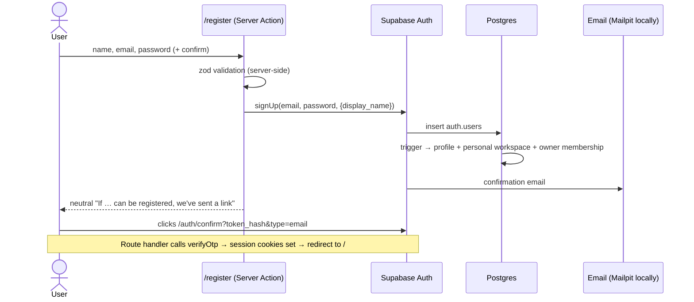

# Authentication and Authorization

Status: **Phase 3 implemented and tested locally** (2026-10-24).
Code: `src/server/auth/`, `src/server/core/`, `src/lib/supabase/`, `src/middleware.ts`,
`src/app/(auth)/`, `src/app/auth/confirm/`, `src/app/reset-password/`.
Database: `supabase/migrations/20261024180000_authorization.sql`.

---

## 1. Overview

| Concern | Implementation |
| --- | --- |
| Identity | Supabase Auth (GoTrue), email + password |
| Registration | Server Action `signUp` → confirmation email (required) |
| Login / logout | Server Actions `signIn` / `signOut` |
| Password reset | `requestPasswordReset` → recovery email → `/reset-password` → `updatePassword` |
| Email links | `/auth/confirm?token_hash=…&type=…` (`verifyOtp`) — works in any browser |
| Sessions | `@supabase/ssr` cookies hardened to HttpOnly / SameSite=Lax / Secure (prod), refreshed by middleware |
| Route protection | `src/middleware.ts` + server-side check in `src/app/(app)/layout.tsx` |
| Server identity | `getCurrentUser()` — `auth.getUser()` (verified with the Auth server), cached per request |
| Authorization | PostgreSQL RLS on every table + least-privilege column grants |
| Collaboration access | Workspace membership with roles owner / editor / commenter / viewer |

Not implemented yet: OAuth providers, MFA, sending invitation emails (Phase 6), account
deletion endpoint (later phase).

## 2. Flows

### 2.1 Registration and email confirmation

- The success message is identical whether or not the email is already registered (no
  account enumeration).
- Sign-in before confirmation returns "Confirm your email address first".

### 2.2 Sign in / sign out

- `/login?next=/calls` — `next` is sanitized by `safeNextPath()` (same-origin paths only;
  rejects absolute, protocol-relative, backslash and control-character values and auth pages).
- Failed sign-in always shows **"Invalid email or password."**
- Sign out (`Account menu → Sign out`) calls `supabase.auth.signOut()` and redirects to
  `/login?signed_out=1`.

### 2.3 Password reset

1. `/forgot-password` → `resetPasswordForEmail(email)`; the response is the same for unknown
   addresses (only rate limiting is surfaced).
2. Recovery email → `/auth/confirm?token_hash=…&type=recovery` → session established →
   `/reset-password`.
3. `updatePassword` validates the new password and calls `auth.updateUser`; redirects to
   `/?password_updated=1`. The old password stops working (E2E-verified).
4. Invalid/expired links redirect to `/forgot-password?error=link_invalid` (recovery) or
   `/login?error=link_invalid` (confirmation).

### 2.4 Email templates

`supabase/templates/confirmation.html` and `recovery.html` (configured in
`supabase/config.toml`) link to `{{ .SiteURL }}/auth/confirm?token_hash={{ .TokenHash }}&type=…`.
The same templates and Site URL must be configured on hosted projects (Phase 9).

## 3. Sessions and route protection

| Layer | Behavior |
| --- | --- |
| `src/middleware.ts` → `updateSession()` | Runs on every non-static request; refreshes the session cookie via `auth.getUser()`; unauthenticated requests to non-public paths → `/login?next=…`; signed-in requests to `/login`, `/register`, `/forgot-password` → `next` or `/` |
| `src/app/(app)/layout.tsx` | Server-side `getCurrentUser()`; redirects to `/login` if missing (defense in depth) |
| `src/app/reset-password/page.tsx` | Requires the recovery session; otherwise `/forgot-password?error=link_invalid` |
| Public paths | `/login`, `/register`, `/forgot-password`, `/auth/*` (`PUBLIC_PATHS` in `src/lib/safe-redirect.ts`) |

Session cookies (`sb-*`) are set with `SESSION_COOKIE_OPTIONS` (`src/lib/supabase/env.ts`):
**`HttpOnly`**, `SameSite=Lax`, `Path=/`, and **`Secure`** in production builds. `@supabase/ssr`
defaults to `httpOnly: false` so browser clients can read the session; this app performs auth
on the server only, so injected scripts cannot read tokens (E2E-verified: cookie flags and
`document.cookie` contains no `sb-` cookie). Access tokens last 1 hour (`jwt_expiry = 3600`);
refresh tokens rotate (`enable_refresh_token_rotation = true`).

Trade-off: a browser-side Supabase client (e.g. for Realtime in Phase 6) cannot read the
session cookie; it must receive a short-lived access token from the server instead.

Server code never trusts `getSession()` for authorization decisions; it uses
`getUser()`, and the database enforces access independently through RLS.

## 4. Password policy

| Rule | Where enforced |
| --- | --- |
| 8–72 characters, at least one letter and one digit | zod (`src/shared/contracts/auth.ts`) and Supabase Auth (`minimum_password_length = 8`, `password_requirements = "letters_digits"`) |
| No strength rules shown at sign-in | `signInSchema` only requires a value |
| Rate limits | Supabase Auth built-ins (`[auth.rate_limit]`), surfaced as "Too many attempts" |

## 5. Workspace membership and roles

- Every user gets a **personal workspace** (owner) at sign-up.
- Users can create more workspaces (`insert` with `owner_id = auth.uid()`); the owner is
  added as a member automatically.
- Exactly one owner per workspace; the owner cannot be demoted or removed directly
  (ownership transfer function arrives in Phase 6).
- Members are added **only** by accepting an invitation (`public.accept_invitation`).

### 5.1 Permission matrix (implemented)

| Operation | Owner | Editor | Commenter | Viewer | Non-member |
| --- | :-: | :-: | :-: | :-: | :-: |
| Read workspace records (companies, recruiters, opportunities, calls, interviews, questions, prep & follow-up tasks, STAR stories, notes, comments, activity, recording metadata) | ✅ | ✅ | ✅ | ✅ | ❌ |
| Create / edit / delete those records | ✅ | ✅ | ❌ | ❌ | ❌ |
| Create recording metadata (upload) | ✅ | ✅ | ❌ | ❌ | ❌ |
| Mark recordings uploaded / delete recordings | server only (Phase 5) | server only | ❌ | ❌ | ❌ |
| Add comments | ✅ | ✅ | ✅ | ❌ | ❌ |
| Edit own comment | ✅ | ✅ | ✅ | — | ❌ |
| Soft-delete any comment | ✅ | ❌ | ❌ | ❌ | ❌ |
| Rename workspace / set retention | ✅ | ❌ | ❌ | ❌ | ❌ |
| Delete workspace | ✅ | ❌ | ❌ | ❌ | ❌ |
| Invite, list or revoke invitations | ✅ | ❌ | ❌ | ❌ | ❌ |
| Change member roles (not to owner), remove members | ✅ | ❌ | ❌ | ❌ | ❌ |
| Leave workspace | — (transfer first) | ✅ | ✅ | ✅ | — |
| See other members' profiles | ✅ | ✅ | ✅ | ✅ | ❌ |

Recording **playback** (signed URLs) will be limited to owner/editor on the server (D4, Phase 5).

## 6. Row Level Security design

### 6.1 Helpers (private `app` schema)

| Function | Purpose |
| --- | --- |
| `app.role_rank(role)` | owner 4, editor 3, commenter 2, viewer 1 |
| `app.has_workspace_role(workspace_id, min_role)` | `STABLE SECURITY DEFINER`; true if `auth.uid()` is a member with ≥ `min_role`. Definer rights avoid recursive RLS on `workspace_members`. |
| `app.shares_workspace_with(user_id)` | profile visibility between co-members |

Both callable helpers reveal only the caller's own memberships, pin `search_path = ''`, and
are not executable by `anon`.

### 6.2 Grants (least privilege)

Supabase's defaults gave `authenticated` every table privilege, **including `TRUNCATE`, which
bypasses RLS**. The migration revokes everything and grants explicitly:

| Table(s) | `authenticated` privileges |
| --- | --- |
| companies, recruiters, opportunities, recruiter_calls, interviews, questions, preparation_tasks, follow_up_tasks, star_stories, shared_notes | SELECT, INSERT, UPDATE, DELETE |
| profiles | SELECT; UPDATE(display_name, headline) |
| workspaces | SELECT, DELETE; INSERT(name, owner_id, recording_retention_days); UPDATE(name, recording_retention_days) |
| workspace_members | SELECT, DELETE; UPDATE(role) |
| workspace_invitations | SELECT(all columns **except token_hash**); INSERT(workspace_id, email, role, token_hash, invited_by); UPDATE(status) |
| recordings | SELECT; INSERT(id, workspace_id, recruiter_call_id, uploaded_by, file_name, storage_path, mime_type, file_size, consent_confirmed_at); UPDATE(duration_seconds) |
| comments | SELECT; INSERT(workspace_id, note_id, author_id, body); UPDATE(body, edited_at, deleted_at) |
| activity_events | SELECT |
| storage_cleanup_queue | none |
| rate_limit_counters | none (Phase 5) |

`anon` has no privileges on any table. Clients cannot choose primary keys except
`recordings.id`, which the server generates to build the storage path.

### 6.3 Policies

| Table | SELECT | INSERT | UPDATE | DELETE |
| --- | --- | --- | --- | --- |
| profiles | self or co-member | — (trigger) | self | — |
| workspaces | member | `owner_id = auth.uid()` | owner | owner |
| workspace_members | member | — (invitation function) | owner; new role ≠ owner | owner, or self (leave) |
| workspace_invitations | owner | owner, `invited_by = auth.uid()`, status pending | owner: pending → revoked only | — |
| 10 domain tables | viewer+ | editor+ | editor+ (USING and WITH CHECK) | editor+ |
| recordings | viewer+ | editor+, `uploaded_by = auth.uid()`, status pending (quota/limits trigger) | editor+ (duration only, via grant) | — (status changes and deletion via service-only functions after API role checks; see STORAGE.md) |
| comments | viewer+ | commenter+, `author_id = auth.uid()` | author (commenter+) or owner; trigger limits owners to `deleted_at` | — |
| activity_events | viewer+ | — | — | — |

`WITH CHECK` on updates prevents moving rows into another workspace; composite foreign keys
(see `DATABASE.md`) prevent links across workspaces.

### 6.4 Invitation acceptance

`public.accept_invitation(p_token text)` (`SECURITY DEFINER`, executable by `authenticated` only):

1. Requires a signed-in user and a token of 32–256 characters.
2. Looks up `sha256(token)` (`FOR UPDATE`); the invitation must be `pending` and unexpired.
3. The invitation email must equal the caller's profile email (case-insensitive).
4. Inserts the membership (existing members keep their role) and marks the invitation
   `accepted` — so a token works once.

Errors: `P0002` invalid/used/revoked/expired (one message, no detail), `42501` email
mismatch, `28000` not signed in. Token generation and emailing are added in Phase 6.

## 7. Tests

| Suite | What it proves | Result |
| --- | --- | --- |
| `supabase/tests/database/006_rls_matrix.test.sql` | 10 domain tables × 5 roles × 4 operations as the real `authenticated` role with JWT claims, + `anon` on all 18 tables | ✅ 218/218 |
| `supabase/tests/database/007_rls_special_cases.test.sql` | profiles, workspaces, members, invitation lifecycle, comments, recordings, activity, cleanup queue, TRUNCATE | ✅ 61/61 |
| `tests/integration/rls-http.test.ts` | isolation through the real HTTP API with real sessions (cross-user read/write, anon, token hash, RPC, profile email) | ✅ 8/8 |
| `tests/unit/*.test.ts` | validation schemas, `safeNextPath` (open-redirect cases), error mapping | ✅ 32/32 |
| `tests/e2e/auth.spec.ts` (Playwright) | route protection, invalid links, register → confirm (Mailpit) → sign out → wrong password → `next` redirect → open-redirect attempt → password reset → old password rejected; reset for unknown email | ✅ 4/4 |

Commands: `npm run test:db`, `npm run test:unit`, `npm run test:integration`,
`npm run test:e2e` (builds and starts the app on port 3000).

## 8. Troubleshooting

| Symptom | Likely cause / fix |
| --- | --- |
| `Supabase is not configured: set NEXT_PUBLIC_SUPABASE_URL…` | Run `npm run env:local`, restart `next dev` |
| Redirect loop to `/login` | Cookies blocked, or app served on a host different from the cookie host. Use `http://localhost:3000` (the configured `site_url`) |
| Confirmation/reset email never arrives (local) | Open Mailpit at <http://127.0.0.1:54324>; check `npx supabase status` lists Mailpit |
| Email link goes to the wrong host | `site_url` in `supabase/config.toml` (local) or Auth settings (hosted) |
| "That link is invalid or has expired" | Links are single-use and expire after 1 hour (`otp_expiry`); request a new one |
| "Confirm your email address first" | Open the confirmation email; locally confirmations are enabled to match production |
| "Too many attempts" | Supabase Auth rate limit; wait, or adjust `[auth.rate_limit]` locally |
| Config changes not applied | `npm run supabase:stop && npm run supabase:start` (data is kept) |
| `permission denied` (42501) from the API | Expected when the user lacks the role; check `workspace_members` |
| Integration tests fail with "Local Supabase is not configured" | Start Supabase and run `npm run env:local` |

## 9. Security assumptions and limitations

- RLS is the authoritative boundary; the publishable key is public by design.
- Any member can see recording **metadata**; audio access will be gated separately (Phase 5).
- The overview greeting and all domain data in the UI are still mock data until Phase 7;
  only identity (header, sign-out) is real.
- Invitations can be created and accepted at the database level; the invite UI, token
  generation and email delivery come in Phase 6.
- No MFA, OAuth or account-deletion flow yet.
