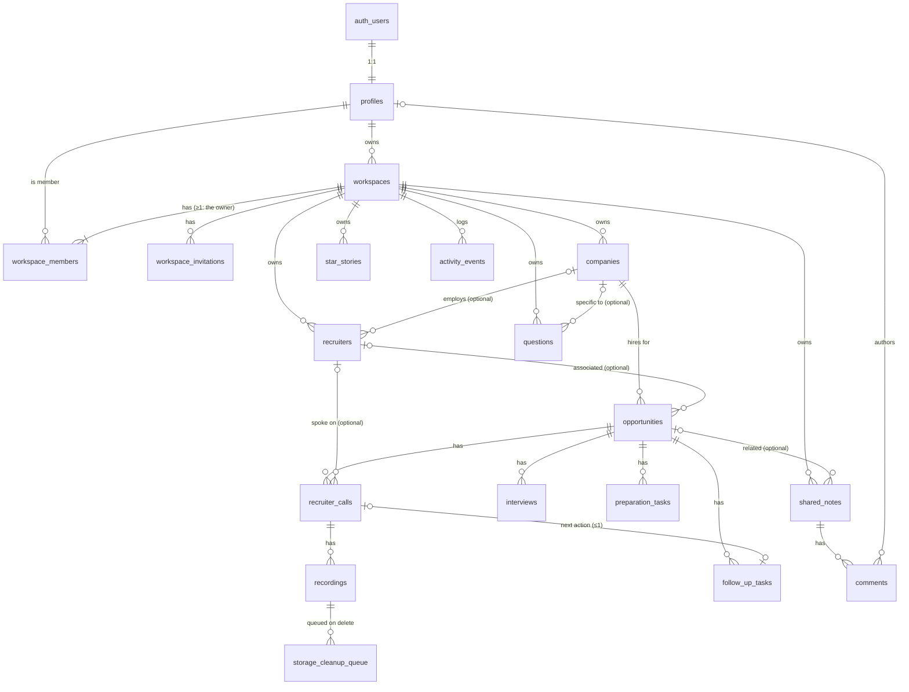

# Database

Status: schema (Phase 2), authorization (Phase 3) and transactional functions (Phase 4)
implemented and tested locally (2026-10-24).
Engine: Supabase PostgreSQL 17 (local stack). Migrations: `supabase/migrations/`.
Tests: `supabase/tests/database/` (pgTAP, 402 assertions).

Row Level Security is enabled and forced on every table. Policies, role helpers and grants
are described in [`AUTHENTICATION.md`](./AUTHENTICATION.md) §6; transactional write functions in §4.4 below.

---

## 1. Overview

| Group | Tables |
| --- | --- |
| Identity & collaboration | `profiles`, `workspaces`, `workspace_members`, `workspace_invitations`, `shared_notes`, `comments`, `activity_events` |
| Recruitment | `companies`, `recruiters`, `opportunities`, `recruiter_calls` |
| Recordings | `recordings`, `storage_cleanup_queue` |
| Interview intelligence | `interviews`, `questions`, `preparation_tasks`, `follow_up_tasks`, `star_stories` |

`follow_up_tasks`, `shared_notes`, `star_stories` and `storage_cleanup_queue` go beyond the
specification's minimum list; they were approved as decision D3 in `ARCHITECTURE.md`.
Recruiter-call Q&A is stored as a validated `jsonb` array (`recruiter_calls.candidate_questions`)
rather than a separate table.

## 2. Entity relationship diagram



## 3. Relationship cardinality

| Relationship | Cardinality | Enforced by |
| --- | --- | --- |
| auth user → profile | 1 : 1 | PK = FK to `auth.users.id`; sign-up trigger |
| profile → owned workspaces | 1 : N | `workspaces.owner_id` |
| workspace → members | 1 : N (≥ 1 owner, exactly one) | owner trigger + partial unique index `workspace_members_one_owner` |
| company → opportunities | 1 : N | `opportunities.company_id` (required) |
| company → recruiters | 0..1 : N | `recruiters.company_id` (optional) |
| recruiter → opportunities / calls | 0..1 : N | optional FKs |
| opportunity → calls / interviews / preparation tasks / follow-ups | 1 : N | required FKs |
| call → recordings | 1 : N | `recordings.recruiter_call_id` |
| call → follow-up | 1 : 0..1 | unique `follow_up_tasks.recruiter_call_id` |
| shared note → comments | 1 : N | `comments.note_id` |

## 4. Integrity rules

### 4.1 Workspace isolation (composite foreign keys)

Every parent that has workspace-owned children exposes `unique (id, workspace_id)`, and
children reference it with `foreign key (parent_id, workspace_id)`. A child can therefore
only point at a parent **in the same workspace** — the database rejects cross-workspace
links regardless of application code. Verified for all 13 child relationships in
`003_relationships.test.sql`.

### 4.2 Other rules

| Rule | Mechanism |
| --- | --- |
| UUID primary keys everywhere | `gen_random_uuid()` defaults |
| One owner per workspace; owner can't be demoted/removed directly | partial unique index + `app.protect_workspace_owner()` trigger (cascading deletes allowed) |
| Owner is always a member | `app.add_workspace_owner()` after-insert trigger (same transaction) |
| Company names unique per workspace (case-insensitive) | unique index on `(workspace_id, lower(name))` |
| One pending invitation per email per workspace; invitations never grant owner | partial unique index; role check |
| Compensation is all-or-nothing and `max ≥ min` | table checks on `opportunities` |
| Enumerations (stage, work mode, statuses, categories…) | `CHECK` constraints |
| Text and array size limits | `CHECK` constraints (see column reference) |
| Candidate Q&A shape | `app.valid_candidate_questions(jsonb)` check: array ≤ 30 of `{question, answer?}` |
| A call's follow-up belongs to the call's opportunity | `app.check_follow_up_call_opportunity()`; moving a call moves its follow-up |
| Recording object paths are server-shaped | check: `{workspace_id}/{recruiter_call_id}/{id}.{mp3\|m4a\|wav}` |
| Recording status consistency | `uploaded` ⇒ `uploaded_at` set; `deleted` ⇔ `deleted_at` set |
| Consent recorded for every recording | `consent_confirmed_at not null` |
| Activity log is append-only | `app.prevent_activity_mutation()` trigger (maintenance roles excepted) |

### 4.3 Maintenance triggers

| Trigger function | Tables | Behavior |
| --- | --- | --- |
| `app.set_updated_at()` | all tables with `updated_at` | sets `updated_at = now()` on update |
| `app.track_stage_change()` | `opportunities` | sets `stage_changed_at` when `stage` changes |
| `app.bump_note_version()` | `shared_notes` | increments `version` on content change; ignores client-set versions |
| `app.handle_new_user()` | `auth.users` (insert) | creates profile + personal workspace (+ owner membership) |
| `app.sync_profile_email()` | `auth.users` (email update) | keeps `profiles.email` in sync |
| `app.enqueue_recording_cleanup()` | `recordings` | queues the object path when a live (`pending`/`uploaded`) recording becomes `deleted`/`failed` or its row is deleted (reason from `app.cleanup_reason`, else `user_delete` / `failed_validation` / `cascade`) |
| `app.guard_recording_status()` | `recordings` | allows only `pending → uploaded/failed/deleted` and `uploaded/failed → deleted` (Phase 5) |
| `app.enforce_recording_limits()` | `recordings` (insert) | workspace quota (pending + uploaded bytes) and 10 live recordings per call, serialized per workspace (Phase 5) |
| `app.apply_retention_change()` | `workspaces` (retention update) | recomputes `delete_after` of uploaded recordings (Phase 5) |

All helper functions live in the private `app` schema (not exposed through the Data API),
pin `search_path = ''`, and are not executable by `anon`.

### 4.4 Transactional write functions (Phase 4)

| Function | Purpose |
| --- | --- |
| `public.save_opportunity(workspace_id, opportunity_id \| null, payload jsonb)` | Create/partially update an opportunity; find-or-create company by name; optional inline recruiter |
| `public.save_recruiter_call(workspace_id, call_id \| null, payload jsonb)` | Create/partially update a call together with its opportunity, recruiter and follow-up |
| `app.resolve_company`, `app.apply_recruiter`, `app.apply_opportunity`, `app.resolve_recruiter_ref` | Building blocks used by the two functions above |

All are `SECURITY INVOKER` (RLS and grants apply), run in one transaction, and use
`jsonb_populate_record(existing_row, patch)` so partial updates change only the keys sent.
Covered by `008_services.test.sql` (atomic rollback, find-or-create, partial updates,
cross-workspace references, permissions).

### 4.5 Collaboration triggers (Phase 6)

| Trigger function | Tables | Behavior |
| --- | --- | --- |
| `app.activity_*` → `app.log_activity` | opportunities, recruiter_calls, interviews, preparation_tasks, follow_up_tasks, recordings, shared_notes, comments, workspace_members, workspace_invitations, workspaces | append important changes to `activity_events` (labels only; skipped while a workspace is being deleted). See COLLABORATION.md §7 |
| `app.broadcast_change()` | D7 tables + shared_notes, recordings, workspace_members, workspaces | `realtime.send` an id-only `change` message to the private topic `workspace:<id>` |
| `app.prepare_invitation()` | workspace_invitations (insert) | expires stale pending invitations; rejects members, duplicates and > 50 pending |
| `app.stamp_note_author()` | shared_notes | sets `created_by` / `updated_by` from the acting user |
| `app.guard_comment_update()` (replaced) | comments | soft delete clears the text; deleted comments immutable; author-only edits; sets `edited_at` |

`comments_body_check` now allows an empty body only for deleted comments.

### 4.6 Recording storage functions (Phase 5, service role only)

| Function | Purpose |
| --- | --- |
| `public.mark_recording_uploaded(id)` | `pending → uploaded`, sets `uploaded_at` and the retention deadline |
| `public.mark_recording_failed(id, reason, cleanup_reason)` | `pending → failed`, queues the object |
| `public.soft_delete_recording(id)` | any live state `→ deleted`, queues the object |
| `public.consume_rate_limit(subject, action, limit, window_seconds)` | fixed-window counter in `rate_limit_counters`; returns false over the limit |
| `public.claim_storage_cleanup(limit)` | claims queue entries (`FOR UPDATE SKIP LOCKED`, 5-minute lease) |
| `public.run_recording_maintenance(abandon_after, tombstone_after)` | abandoned uploads, retention, orphan reconciliation, tombstone/queue/counter purge |
| `public.uploaded_recording_count(recruiter_calls)` | computed field for the API (`authenticated`, RLS applies) |

The bucket itself (`storage.buckets` row `recordings`: private, 100 MiB, MP3/M4A/WAV MIME
types) is created by the same migration; see [STORAGE.md](STORAGE.md).

## 5. Deletion behavior

| When this is deleted… | Effect |
| --- | --- |
| auth user | profile deleted → workspaces they **own** deleted (cascade) → memberships elsewhere removed; authored rows keep data with `created_by`/`author_id`/`uploaded_by` set to null |
| workspace | everything in it is deleted; recording objects are queued for purge (queue rows survive) |
| company | **blocked** while any opportunity references it (`NO ACTION`); recruiters/questions referencing it are unlinked (set null) |
| recruiter | unlinked from opportunities and calls (set null) |
| opportunity | its calls, interviews, preparation tasks and follow-ups are deleted; recordings of those calls are deleted and queued; shared notes are unlinked |
| recruiter call | its recordings (queued for purge) and its follow-up are deleted |
| shared note | its comments are deleted |
| recording | soft delete (`status='deleted'`) queues the object; hard delete queues it unless already queued; tombstones (`failed`/`deleted`) are purged after 30 days |

`NO ACTION` is used instead of `RESTRICT` on `opportunities → companies` so a workspace
deletion cascades regardless of internal trigger order, while a direct company delete is
still rejected.

## 6. Privileges

- Default privileges grant nothing to `anon` on new public tables, sequences and functions,
  and functions grant nothing to `PUBLIC`.
- `authenticated` has explicit least-privilege table and column grants (Supabase's broad
  defaults, including `TRUNCATE`, were revoked in Phase 3). Full table in
  [`AUTHENTICATION.md`](./AUTHENTICATION.md) §6.2. `storage_cleanup_queue` and `rate_limit_counters` grant nothing to client roles.
- Executable by `authenticated`: `app.valid_candidate_questions` (check constraint),
  `app.has_workspace_role` / `app.shares_workspace_with` (policies), `public.accept_invitation`,
  `public.preview_invitation` (Phase 6), `app.current_actor` / `app.workspace_topic_id` (Phase 6, not definer),
  and the Phase 4 write functions. No other `SECURITY DEFINER` function is callable by clients
  (asserted by `001_schema.test.sql`).

## 7. Migrations

| File | Contents |
| --- | --- |
| `20261024170000_baseline.sql` | default privileges, `citext`, private `app` schema, `set_updated_at` |
| `20261024170100_identity.sql` | profiles, workspaces, members, invitations, owner + sign-up triggers |
| `20261024170200_recruitment.sql` | companies, recruiters, opportunities, recruiter calls |
| `20261024170300_recordings.sql` | recordings, storage cleanup queue + triggers |
| `20261024170400_interview_intelligence.sql` | interviews, questions, preparation/follow-up tasks, STAR stories |
| `20261024170500_collaboration.sql` | shared notes, comments, activity events |
| `20261024180000_authorization.sql` | role helpers, least-privilege grants, RLS policies, `accept_invitation` (Phase 3) |
| `20261024190000_application_services.sql` | `save_opportunity`, `save_recruiter_call` and helpers (Phase 4) |
| `20261024191000_workspace_insert_id.sql` | allow the API to supply a new workspace's id (Phase 4) |
| `20261024200000_recording_storage.sql` | private `recordings` bucket, status guard, quota/limits, retention, rate limits, maintenance functions (Phase 5) |
| `20261025100000_collaboration_services.sql` | activity triggers, Realtime broadcast triggers + `realtime.messages` policy, invitation checks and `preview_invitation`, comment soft delete, note authorship, case-insensitive `accept_invitation` fix (Phase 6) |
| `20261025120000_broadcast_reference_data.sql` | Realtime change notifications for companies, recruiters, questions, STAR stories (Phase 7) |

### 7.1 Commands

```bash
npm run db:new -- <name>     # new empty migration file (npx supabase migration new <name>)
npx supabase migration up    # apply pending migrations to the local DB (keeps data)
npm run db:reset             # rebuild local DB from all migrations (+ seed) — DISCARDS local data
npm run db:lint              # static checks on functions (plpgsql_check)
npm run test:db              # run pgTAP tests (supabase test db)
npm run db:types             # regenerate src/server/core/database.types.ts after schema changes
npx supabase migration list --local
```

### 7.2 Rules

1. Every schema change is a new, timestamped migration file — never edit the database
   only through Studio.
2. Migrations already applied to a shared environment (staging/production) are never edited;
   add a new migration instead. (The Phase 2 files were adjusted only while they existed
   solely in the local development database.)
3. A migration that adds a table must also enable + force RLS for it and add its policies
   and grants. `001_schema.test.sql` fails if any public table lacks forced RLS.
4. Destructive changes follow expand → migrate → contract across releases.
5. Run `npm run db:reset && npm run test:db` before committing migration changes.

## 8. Table reference

Generated from the local database catalog after applying all migrations (2026-10-24).
Check constraints are listed in the migration files.

### `profiles`

One row per auth user (1:1 with `auth.users`), created by the sign-up trigger.

| Column | Type | Null | Default |
| --- | --- | --- | --- |
| `id` | uuid | not null |  |
| `email` | citext | not null |  |
| `display_name` | text | not null |  |
| `headline` | text | null |  |
| `created_at` | timestamptz | not null | `now()` |
| `updated_at` | timestamptz | not null | `now()` |

**Foreign keys**

- `FOREIGN KEY (id) REFERENCES auth.users(id) ON DELETE CASCADE`

**Indexes**

- `profiles_email_key` (email)
- `profiles_pkey` (id)

### `workspaces`

Tenant boundary. Owned by one profile; deleting it cascades to every workspace record.

| Column | Type | Null | Default |
| --- | --- | --- | --- |
| `id` | uuid | not null | `gen_random_uuid()` |
| `name` | text | not null |  |
| `owner_id` | uuid | not null |  |
| `recording_retention_days` | integer | null |  |
| `storage_quota_bytes` | bigint | not null | `'2147483648'` |
| `created_at` | timestamptz | not null | `now()` |
| `updated_at` | timestamptz | not null | `now()` |

**Foreign keys**

- `FOREIGN KEY (owner_id) REFERENCES profiles(id) ON DELETE CASCADE`

**Indexes**

- `workspaces_owner_idx` (owner_id)
- `workspaces_pkey` (id)

### `workspace_members`

Membership and role (`owner`/`editor`/`commenter`/`viewer`) of a profile in a workspace.

| Column | Type | Null | Default |
| --- | --- | --- | --- |
| `workspace_id` | uuid | not null |  |
| `user_id` | uuid | not null |  |
| `role` | text | not null |  |
| `created_at` | timestamptz | not null | `now()` |
| `updated_at` | timestamptz | not null | `now()` |

**Foreign keys**

- `FOREIGN KEY (user_id) REFERENCES profiles(id) ON DELETE CASCADE`
- `FOREIGN KEY (workspace_id) REFERENCES workspaces(id) ON DELETE CASCADE`

**Indexes**

- `workspace_members_one_owner` (workspace_id) WHERE (role = 'owner'::text)
- `workspace_members_pkey` (workspace_id, user_id)
- `workspace_members_user_idx` (user_id)

### `workspace_invitations`

Pending/processed invitations. Only the SHA-256 of the token is stored.

| Column | Type | Null | Default |
| --- | --- | --- | --- |
| `id` | uuid | not null | `gen_random_uuid()` |
| `workspace_id` | uuid | not null |  |
| `email` | citext | not null |  |
| `role` | text | not null |  |
| `token_hash` | bytea | not null |  |
| `invited_by` | uuid | null |  |
| `status` | text | not null | `'pending'` |
| `expires_at` | timestamptz | not null | `(now() + '7 days')` |
| `accepted_by` | uuid | null |  |
| `accepted_at` | timestamptz | null |  |
| `created_at` | timestamptz | not null | `now()` |
| `updated_at` | timestamptz | not null | `now()` |

**Foreign keys**

- `FOREIGN KEY (accepted_by) REFERENCES profiles(id) ON DELETE SET NULL`
- `FOREIGN KEY (invited_by) REFERENCES profiles(id) ON DELETE SET NULL`
- `FOREIGN KEY (workspace_id) REFERENCES workspaces(id) ON DELETE CASCADE`

**Indexes**

- `workspace_invitations_one_pending` (workspace_id, email) WHERE (status = 'pending'::text)
- `workspace_invitations_pkey` (id)
- `workspace_invitations_token_hash_key` (token_hash)
- `workspace_invitations_workspace_idx` (workspace_id)

### `companies`

Hiring companies tracked in a workspace.

| Column | Type | Null | Default |
| --- | --- | --- | --- |
| `id` | uuid | not null | `gen_random_uuid()` |
| `workspace_id` | uuid | not null |  |
| `name` | text | not null |  |
| `industry` | text | null |  |
| `headquarters` | text | null |  |
| `website` | text | null |  |
| `created_at` | timestamptz | not null | `now()` |
| `updated_at` | timestamptz | not null | `now()` |

**Foreign keys**

- `FOREIGN KEY (workspace_id) REFERENCES workspaces(id) ON DELETE CASCADE`

**Indexes**

- `companies_id_workspace_id_key` (id, workspace_id)
- `companies_name_per_workspace` (workspace_id, lower(name))
- `companies_pkey` (id)

### `recruiters`

Recruiter contacts, optionally linked to a company.

| Column | Type | Null | Default |
| --- | --- | --- | --- |
| `id` | uuid | not null | `gen_random_uuid()` |
| `workspace_id` | uuid | not null |  |
| `company_id` | uuid | null |  |
| `name` | text | not null |  |
| `email` | citext | null |  |
| `phone` | text | null |  |
| `agency` | text | null |  |
| `created_at` | timestamptz | not null | `now()` |
| `updated_at` | timestamptz | not null | `now()` |

**Foreign keys**

- `FOREIGN KEY (company_id, workspace_id) REFERENCES companies(id, workspace_id) ON DELETE SET NULL (company_id)`
- `FOREIGN KEY (workspace_id) REFERENCES workspaces(id) ON DELETE CASCADE`

**Indexes**

- `recruiters_company_idx` (company_id)
- `recruiters_id_workspace_id_key` (id, workspace_id)
- `recruiters_pkey` (id)
- `recruiters_workspace_name_idx` (workspace_id, name)

### `opportunities`

Job opportunities moving through the pipeline stages.

| Column | Type | Null | Default |
| --- | --- | --- | --- |
| `id` | uuid | not null | `gen_random_uuid()` |
| `workspace_id` | uuid | not null |  |
| `company_id` | uuid | not null |  |
| `recruiter_id` | uuid | null |  |
| `title` | text | not null |  |
| `location` | text | not null | `''` |
| `work_mode` | text | not null |  |
| `employment_type` | text | not null |  |
| `comp_min` | numeric(12,2) | null |  |
| `comp_max` | numeric(12,2) | null |  |
| `comp_currency` | char(3) | not null | `'USD'` |
| `comp_period` | text | null |  |
| `stage` | text | not null | `'new'` |
| `stage_changed_at` | timestamptz | not null | `now()` |
| `job_description` | text | not null | `''` |
| `required_skills` | text[] | not null | `'{}'` |
| `preferred_skills` | text[] | not null | `'{}'` |
| `prep_notes` | text | not null | `''` |
| `created_by` | uuid | null |  |
| `created_at` | timestamptz | not null | `now()` |
| `updated_at` | timestamptz | not null | `now()` |

**Foreign keys**

- `FOREIGN KEY (company_id, workspace_id) REFERENCES companies(id, workspace_id)`
- `FOREIGN KEY (created_by) REFERENCES profiles(id) ON DELETE SET NULL`
- `FOREIGN KEY (recruiter_id, workspace_id) REFERENCES recruiters(id, workspace_id) ON DELETE SET NULL (recruiter_id)`
- `FOREIGN KEY (workspace_id) REFERENCES workspaces(id) ON DELETE CASCADE`

**Indexes**

- `opportunities_company_idx` (company_id)
- `opportunities_id_workspace_id_key` (id, workspace_id)
- `opportunities_pkey` (id)
- `opportunities_recruiter_idx` (recruiter_id)
- `opportunities_workspace_stage_idx` (workspace_id, stage, updated_at DESC)
- `opportunities_workspace_updated_idx` (workspace_id, updated_at DESC)

### `recruiter_calls`

Structured notes from recruiter phone calls. `candidate_questions` holds the Q&A array.

| Column | Type | Null | Default |
| --- | --- | --- | --- |
| `id` | uuid | not null | `gen_random_uuid()` |
| `workspace_id` | uuid | not null |  |
| `opportunity_id` | uuid | not null |  |
| `recruiter_id` | uuid | null |  |
| `call_at` | timestamptz | not null |  |
| `duration_minutes` | integer | not null |  |
| `hiring_manager_priorities` | text[] | not null | `'{}'` |
| `interview_stages` | text[] | not null | `'{}'` |
| `recruiter_advice` | text | not null | `''` |
| `technical_topics` | text[] | not null | `'{}'` |
| `behavioral_themes` | text[] | not null | `'{}'` |
| `red_flags` | text[] | not null | `'{}'` |
| `candidate_questions` | jsonb | not null | `'[]'` |
| `interest_level` | smallint | not null |  |
| `notes` | text | not null | `''` |
| `created_by` | uuid | null |  |
| `created_at` | timestamptz | not null | `now()` |
| `updated_at` | timestamptz | not null | `now()` |

**Foreign keys**

- `FOREIGN KEY (created_by) REFERENCES profiles(id) ON DELETE SET NULL`
- `FOREIGN KEY (opportunity_id, workspace_id) REFERENCES opportunities(id, workspace_id) ON DELETE CASCADE`
- `FOREIGN KEY (recruiter_id, workspace_id) REFERENCES recruiters(id, workspace_id) ON DELETE SET NULL (recruiter_id)`
- `FOREIGN KEY (workspace_id) REFERENCES workspaces(id) ON DELETE CASCADE`

**Indexes**

- `recruiter_calls_id_workspace_id_key` (id, workspace_id)
- `recruiter_calls_opportunity_idx` (opportunity_id)
- `recruiter_calls_pkey` (id)
- `recruiter_calls_recruiter_idx` (recruiter_id)
- `recruiter_calls_workspace_time_idx` (workspace_id, call_at DESC)

### `recordings`

Metadata for externally created recordings stored in private Storage. No audio in the database.

| Column | Type | Null | Default |
| --- | --- | --- | --- |
| `id` | uuid | not null | `gen_random_uuid()` |
| `workspace_id` | uuid | not null |  |
| `recruiter_call_id` | uuid | not null |  |
| `uploaded_by` | uuid | null |  |
| `file_name` | text | not null |  |
| `storage_path` | text | not null |  |
| `mime_type` | text | not null |  |
| `file_size` | bigint | not null |  |
| `duration_seconds` | integer | null |  |
| `status` | text | not null | `'pending'` |
| `failure_reason` | text | null |  |
| `consent_confirmed_at` | timestamptz | not null |  |
| `uploaded_at` | timestamptz | null |  |
| `delete_after` | timestamptz | null |  |
| `deleted_at` | timestamptz | null |  |
| `created_at` | timestamptz | not null | `now()` |
| `updated_at` | timestamptz | not null | `now()` |

**Foreign keys**

- `FOREIGN KEY (recruiter_call_id, workspace_id) REFERENCES recruiter_calls(id, workspace_id) ON DELETE CASCADE`
- `FOREIGN KEY (uploaded_by) REFERENCES profiles(id) ON DELETE SET NULL`

**Indexes**

- `recordings_call_idx` (recruiter_call_id) WHERE (status <> 'deleted'::text)
- `recordings_pending_idx` (created_at) WHERE (status = 'pending'::text)
- `recordings_pkey` (id)
- `recordings_retention_idx` (delete_after) WHERE (status = 'uploaded'::text)
- `recordings_storage_path_key` (storage_path)
- `recordings_workspace_status_idx` (workspace_id, status)

### `storage_cleanup_queue`

Storage objects awaiting deletion (filled by triggers, drained by a job). Service-only.

| Column | Type | Null | Default |
| --- | --- | --- | --- |
| `id` | uuid | not null | `gen_random_uuid()` |
| `workspace_id` | uuid | not null |  |
| `bucket` | text | not null |  |
| `storage_path` | text | not null |  |
| `reason` | text | not null |  |
| `attempts` | integer | not null | `0` |
| `last_error` | text | null |  |
| `enqueued_at` | timestamptz | not null | `now()` |
| `completed_at` | timestamptz | null |  |
| `locked_until` | timestamptz | null |  |

**Indexes**

- `storage_cleanup_queue_pending_idx` (enqueued_at) WHERE (completed_at IS NULL)
- `storage_cleanup_queue_pkey` (id)

### `rate_limit_counters`

Per-user fixed-window counters for actions that mint signed URLs (Phase 5). Service-only.

| Column | Type | Null | Default |
| --- | --- | --- | --- |
| `id` | uuid | not null | `gen_random_uuid()` |
| `subject` | uuid | not null |  |
| `action` | text | not null |  |
| `window_start` | timestamptz | not null |  |
| `hits` | integer | not null | `0` |

**Indexes**

- `rate_limit_counters_pkey` (id)
- `rate_limit_counters_subject_action_window_start_key` (subject, action, window_start)

### `interviews`

Scheduled interviews with stage, status and outcome.

| Column | Type | Null | Default |
| --- | --- | --- | --- |
| `id` | uuid | not null | `gen_random_uuid()` |
| `workspace_id` | uuid | not null |  |
| `opportunity_id` | uuid | not null |  |
| `title` | text | not null |  |
| `stage` | text | not null |  |
| `scheduled_at` | timestamptz | not null |  |
| `duration_minutes` | integer | not null |  |
| `format` | text | not null |  |
| `interviewers` | text[] | not null | `'{}'` |
| `status` | text | not null | `'scheduled'` |
| `outcome` | text | not null | `'pending'` |
| `notes` | text | not null | `''` |
| `created_by` | uuid | null |  |
| `created_at` | timestamptz | not null | `now()` |
| `updated_at` | timestamptz | not null | `now()` |

**Foreign keys**

- `FOREIGN KEY (created_by) REFERENCES profiles(id) ON DELETE SET NULL`
- `FOREIGN KEY (opportunity_id, workspace_id) REFERENCES opportunities(id, workspace_id) ON DELETE CASCADE`

**Indexes**

- `interviews_opportunity_idx` (opportunity_id)
- `interviews_pkey` (id)
- `interviews_workspace_time_idx` (workspace_id, scheduled_at)

### `questions`

Interview question bank, optionally company-specific.

| Column | Type | Null | Default |
| --- | --- | --- | --- |
| `id` | uuid | not null | `gen_random_uuid()` |
| `workspace_id` | uuid | not null |  |
| `company_id` | uuid | null |  |
| `type` | text | not null |  |
| `topic` | text | not null |  |
| `difficulty` | text | not null |  |
| `question` | text | not null |  |
| `answer_notes` | text | not null | `''` |
| `created_by` | uuid | null |  |
| `created_at` | timestamptz | not null | `now()` |
| `updated_at` | timestamptz | not null | `now()` |

**Foreign keys**

- `FOREIGN KEY (company_id, workspace_id) REFERENCES companies(id, workspace_id) ON DELETE SET NULL (company_id)`
- `FOREIGN KEY (created_by) REFERENCES profiles(id) ON DELETE SET NULL`
- `FOREIGN KEY (workspace_id) REFERENCES workspaces(id) ON DELETE CASCADE`

**Indexes**

- `questions_company_idx` (company_id)
- `questions_pkey` (id)
- `questions_workspace_filter_idx` (workspace_id, type, topic)

### `preparation_tasks`

Interview preparation checklist items for an opportunity.

| Column | Type | Null | Default |
| --- | --- | --- | --- |
| `id` | uuid | not null | `gen_random_uuid()` |
| `workspace_id` | uuid | not null |  |
| `opportunity_id` | uuid | not null |  |
| `title` | text | not null |  |
| `category` | text | not null |  |
| `due_date` | date | null |  |
| `completed_at` | timestamptz | null |  |
| `created_by` | uuid | null |  |
| `created_at` | timestamptz | not null | `now()` |
| `updated_at` | timestamptz | not null | `now()` |

**Foreign keys**

- `FOREIGN KEY (created_by) REFERENCES profiles(id) ON DELETE SET NULL`
- `FOREIGN KEY (opportunity_id, workspace_id) REFERENCES opportunities(id, workspace_id) ON DELETE CASCADE`

**Indexes**

- `preparation_tasks_open_idx` (workspace_id, due_date) WHERE (completed_at IS NULL)
- `preparation_tasks_opportunity_idx` (opportunity_id)
- `preparation_tasks_pkey` (id)

### `follow_up_tasks`

Follow-up actions with due dates; at most one per recruiter call.

| Column | Type | Null | Default |
| --- | --- | --- | --- |
| `id` | uuid | not null | `gen_random_uuid()` |
| `workspace_id` | uuid | not null |  |
| `opportunity_id` | uuid | not null |  |
| `recruiter_call_id` | uuid | null |  |
| `title` | text | not null |  |
| `due_date` | date | not null |  |
| `completed_at` | timestamptz | null |  |
| `created_by` | uuid | null |  |
| `created_at` | timestamptz | not null | `now()` |
| `updated_at` | timestamptz | not null | `now()` |

**Foreign keys**

- `FOREIGN KEY (created_by) REFERENCES profiles(id) ON DELETE SET NULL`
- `FOREIGN KEY (opportunity_id, workspace_id) REFERENCES opportunities(id, workspace_id) ON DELETE CASCADE`
- `FOREIGN KEY (recruiter_call_id, workspace_id) REFERENCES recruiter_calls(id, workspace_id) ON DELETE CASCADE`

**Indexes**

- `follow_up_tasks_open_idx` (workspace_id, due_date) WHERE (completed_at IS NULL)
- `follow_up_tasks_opportunity_idx` (opportunity_id)
- `follow_up_tasks_pkey` (id)
- `follow_up_tasks_recruiter_call_id_key` (recruiter_call_id)

### `star_stories`

Reusable behavioral STAR stories.

| Column | Type | Null | Default |
| --- | --- | --- | --- |
| `id` | uuid | not null | `gen_random_uuid()` |
| `workspace_id` | uuid | not null |  |
| `title` | text | not null |  |
| `situation` | text | not null | `''` |
| `task` | text | not null | `''` |
| `action` | text | not null | `''` |
| `result` | text | not null | `''` |
| `themes` | text[] | not null | `'{}'` |
| `created_by` | uuid | null |  |
| `created_at` | timestamptz | not null | `now()` |
| `updated_at` | timestamptz | not null | `now()` |

**Foreign keys**

- `FOREIGN KEY (created_by) REFERENCES profiles(id) ON DELETE SET NULL`
- `FOREIGN KEY (workspace_id) REFERENCES workspaces(id) ON DELETE CASCADE`

**Indexes**

- `star_stories_pkey` (id)
- `star_stories_workspace_idx` (workspace_id, updated_at DESC)

### `shared_notes`

Workspace notes, optionally linked to an opportunity; `version` supports optimistic concurrency.

| Column | Type | Null | Default |
| --- | --- | --- | --- |
| `id` | uuid | not null | `gen_random_uuid()` |
| `workspace_id` | uuid | not null |  |
| `opportunity_id` | uuid | null |  |
| `title` | text | not null |  |
| `body` | text | not null | `''` |
| `version` | integer | not null | `1` |
| `created_by` | uuid | null |  |
| `updated_by` | uuid | null |  |
| `created_at` | timestamptz | not null | `now()` |
| `updated_at` | timestamptz | not null | `now()` |

**Foreign keys**

- `FOREIGN KEY (created_by) REFERENCES profiles(id) ON DELETE SET NULL`
- `FOREIGN KEY (opportunity_id, workspace_id) REFERENCES opportunities(id, workspace_id) ON DELETE SET NULL (opportunity_id)`
- `FOREIGN KEY (updated_by) REFERENCES profiles(id) ON DELETE SET NULL`
- `FOREIGN KEY (workspace_id) REFERENCES workspaces(id) ON DELETE CASCADE`

**Indexes**

- `shared_notes_id_workspace_id_key` (id, workspace_id)
- `shared_notes_opportunity_idx` (opportunity_id)
- `shared_notes_pkey` (id)
- `shared_notes_workspace_idx` (workspace_id, updated_at DESC)

### `comments`

Comments on shared notes (soft-deletable).

| Column | Type | Null | Default |
| --- | --- | --- | --- |
| `id` | uuid | not null | `gen_random_uuid()` |
| `workspace_id` | uuid | not null |  |
| `note_id` | uuid | not null |  |
| `author_id` | uuid | null |  |
| `body` | text | not null |  |
| `edited_at` | timestamptz | null |  |
| `deleted_at` | timestamptz | null |  |
| `created_at` | timestamptz | not null | `now()` |
| `updated_at` | timestamptz | not null | `now()` |

**Foreign keys**

- `FOREIGN KEY (author_id) REFERENCES profiles(id) ON DELETE SET NULL`
- `FOREIGN KEY (note_id, workspace_id) REFERENCES shared_notes(id, workspace_id) ON DELETE CASCADE`

**Indexes**

- `comments_author_idx` (author_id)
- `comments_note_idx` (note_id, created_at)
- `comments_pkey` (id)

### `activity_events`

Append-only log of important changes (labels only, no sensitive content).

| Column | Type | Null | Default |
| --- | --- | --- | --- |
| `id` | uuid | not null | `gen_random_uuid()` |
| `workspace_id` | uuid | not null |  |
| `actor_id` | uuid | null |  |
| `action` | text | not null |  |
| `entity_type` | text | not null |  |
| `entity_id` | uuid | null |  |
| `metadata` | jsonb | not null | `'{}'` |
| `created_at` | timestamptz | not null | `now()` |

**Foreign keys**

- `FOREIGN KEY (actor_id) REFERENCES profiles(id) ON DELETE SET NULL`
- `FOREIGN KEY (workspace_id) REFERENCES workspaces(id) ON DELETE CASCADE`

**Indexes**

- `activity_events_pkey` (id)
- `activity_events_workspace_time_idx` (workspace_id, created_at DESC)
